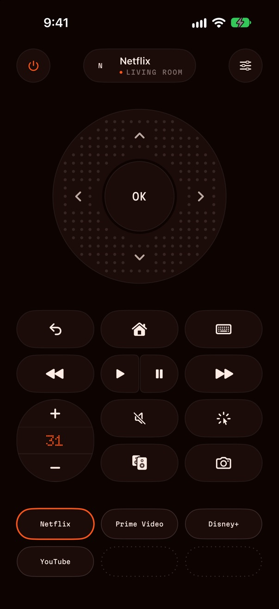
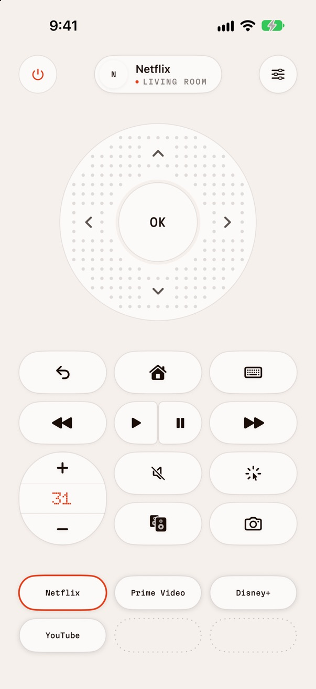
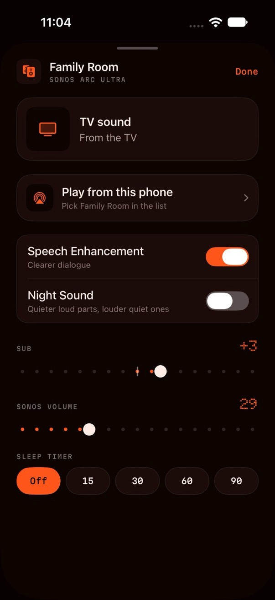
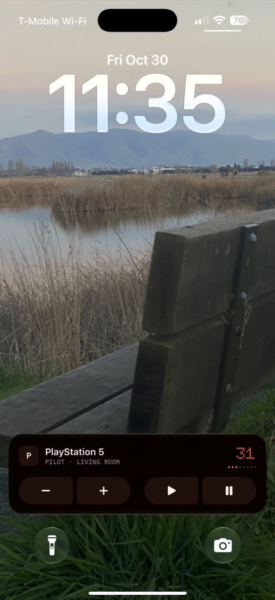

# Pilot

An iPhone remote for my LG TV, and the Sonos under it.

My LG remote was painful: always changing batteries, buttons that barely worked, and most of them for things I never use. I always have my phone on me, so I built one with [Claude Code](https://claude.com/claude-code). The story is on my site: [My TV remote was bad, so I built one on my phone](https://savi.fyi/notes/built-my-own-tv-remote).

  
  
  
  

## What it does

- Wheel, back, home, play and pause, mute, and a pointer you steer by tilting the phone
- Types into the TV's search boxes with the phone's keyboard
- Opens apps and switches inputs; you pick the six apps at the bottom
- Takes a screenshot of what's on the TV and saves it to Photos (protected video comes back black, that's the TV's rule)
- Turns the TV on (Wake-on-LAN) and off
- Volume goes straight to a Sonos on the same Wi-Fi, with a sheet for the speaker's own settings
- A Lock Screen panel for volume and play
- Finds the TV on the Wi-Fi, and finds it again if the router gives it a new address

## Nothing hacky

LG TVs already let apps on the same Wi-Fi control them, the same way LG's own phone app does. The first time, the TV asks on screen and you press OK. Pilot keeps that pairing on the phone. Sonos speakers answer on the local network the same way.

## Build it

Needs a Mac with a recent Xcode, an iPhone on iOS 17+, and an LG webOS TV on the same Wi-Fi.

1. Open `TVRemote.xcodeproj`.
2. Under Signing & Capabilities, pick your own team for both targets (`TVRemote` and `PilotWidgets`), and change the bundle IDs from `fyi.savi.…` to your own.
3. Plug in your iPhone and run.

The project is generated from `project.yml` with [XcodeGen](https://github.com/yonaskolb/XcodeGen), if you'd rather edit that and regenerate. In debug builds, launching with `-demo` shows the remote without a TV.

## Credits

Fonts: [Doto](https://github.com/oliverlalan/Doto) and [Martian Mono](https://github.com/evilmartians/mono), both under the SIL Open Font License (`TVRemote/Fonts`).

Not made by or affiliated with LG or Sonos.

## License

MIT
